# MoE disaggregation benchmark

**Aggregated or prefill/decode-disaggregated serving for a mixture-of-experts model? Ranked by requests that actually meet a latency target.**

[-6250d6)](https://huggingface.co/Qwen/Qwen3-30B-A3B)

## Two takeaways

1. **On one node, aggregated serving won.** On chat it served 3.2x more requests per second per GPU within target than the best disaggregated layout (4x H100); on long prompts the two tied. 8x A100 points the same way.
2. **The usual throughput-vs-speed chart overstates disaggregation by about 50%.** Its best points make users wait over 30 s for the first token. Rank layouts only on points that meet your latency target.

Target: first token within 2 s and at most 50 ms per token, for at least 90% of requests.

> <i>Drop the points that miss the first-token target and the best disaggregated throughput falls from 1,368 to 915 tokens/s per GPU.</i>

> <i>Disaggregation streams tokens smoothly, but the wait moves to the prefill queue: first-token time is what it trades away.</i>

> <i>When shared prefixes overflow GPU memory, FP8 KV plus CPU offload carries twice the BF16 throughput.</i>

## Go deeper

| Page | What you get |
|---|---|
| [Results at a glance](docs/results.md) | Every headline number with its conditions, and how it compares with MLPerf limits and InferenceX tiers |
| [H100: aggregated vs disaggregated](docs/01-h100-aggregated-vs-disaggregated.md) | The ranking, both frontiers, where requests wait |
| [KV transfer and block size](docs/02-kv-transfer-block-size.md) | The one flag that made disaggregation 2.5x better |
| [KV capacity levers](docs/03-kv-capacity-levers.md) | FP8 KV, CPU offload, flow control, each with its cost |
| [A100: aggregated vs disaggregated](docs/04-a100-aggregated-vs-disaggregated.md) | Why eight small replicas beat one large server |
| [Routing and prefix hits](docs/05-routing-and-prefix-hits.md) | When prefix-aware routing pays, and when it creates a hotspot |
| [Agentic load](docs/06-agentic.md) · [Autoscaling](docs/07-autoscaling.md) | Who waits under multi-turn load; why new pods sat idle |
| [Method](docs/00-method.md) · [Not measured](docs/08-not-measured.md) · [Glossary](docs/glossary.md) · [Reproduce](docs/reproduce.md) | How it was measured, what it does not show, and how to re-run it |

**Re-rank for your own target:** change the latency bounds in [`scripts/derive.py`](scripts/derive.py); the 286k per-request records in [`data/requests/`](data/requests) rebuild every table.

Related: [moe-agentic-serving-benchmark](https://github.com/richajoy/moe-agentic-serving-benchmark) (agent sessions on a 235B MoE, 8x H100) · [llm-inference-performance](https://github.com/richajoy/llm-inference-performance) (which serving knob moves which metric, from first principles).

## License

[Apache-2.0](LICENSE).
