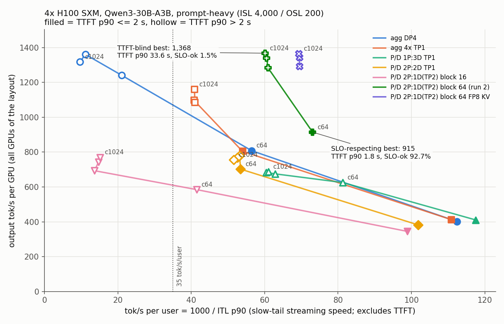
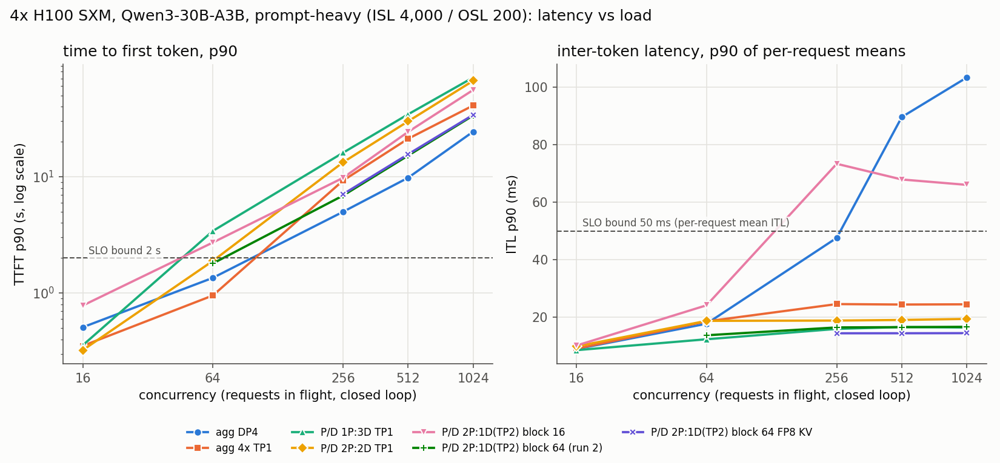
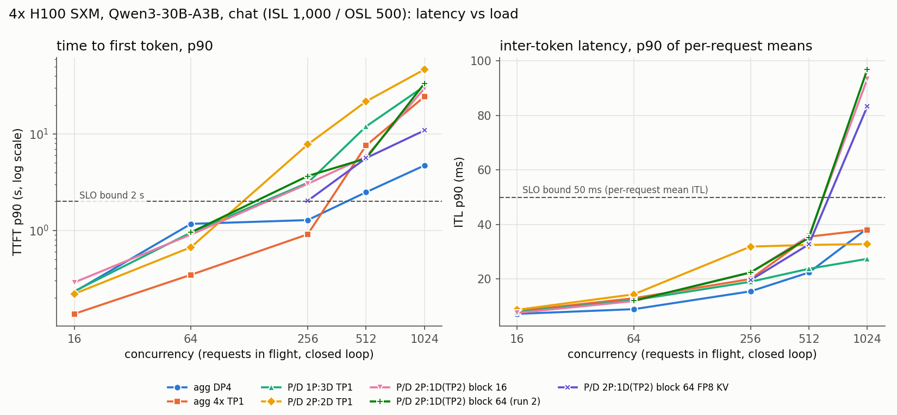

# H100: aggregated vs prefill/decode disaggregated serving

> **What you get from this page:** which serving layout gives the most SLO-meeting requests per GPU on 4x H100 for an MoE model, how big the margin is, why the usual throughput-vs-interactivity chart overstates disaggregation by about 50%, and where each layout makes requests wait.

Terms: **P/D** (prefill/decode disaggregation) runs prompt processing and token generation in separate GPU pools and copies the KV cache between them. **Aggregated** serving runs both in one engine. **TP1 / TP2** = a model copy on 1 or 2 GPUs. **DP4** = one vLLM server across 4 GPUs with the MoE experts split 4 ways. Full list: [glossary](glossary.md).

## The answer first

| Question | Answer | Conditions |
|---|---|---|
| Chat (1,000 in / 500 out): which layout wins? | **Aggregated DP4, by 3.2x.** 7.86 vs 2.48 req/s/GPU of goodput for the best P/D layout | Best point with >= 90% of requests meeting TTFT <= 2 s and ITL <= 50 ms. agg DP4 at c256: TTFT p90 1.28 s, ITL p90 15.5 ms. Single runs |
| Prompt-heavy (4,000 in / 200 out): which layout wins? | **A tie.** P/D 2P(TP1):1D(TP2) at KV block 64 gives 4.24 req/s/GPU, agg DP4 4.04, agg 4x TP1 4.02 | >= 90% attainment, all at c64. The P/D value is replicated (4.23 in the other run); the 5% gap is inside run noise |
| And at any attainment? | agg DP4 peaks higher: **4.65 vs 4.24** (+10%) | agg DP4's peak is at c256 where only 74.9% of requests meet the SLO (TTFT p90 4.99 s). Not decisive |
| How much does a TTFT-blind frontier overstate P/D? | **+49.6%**: 1,368 vs 915 output tok/s/GPU at >= 35 tok/s per user | The 1,368 point has TTFT p90 33.6 s and 1.5% SLO-ok; 915 is the replicated block-64 P/D point at c64 (TTFT p90 1.80 s). The single-run block-128 point gives 919 (+48.9%) |
| What does P/D buy, and what does it cost? | A flat stream (ITL p90 13.7 to 16.6 ms from c64 to c1024, vs 17.7 to 103 ms on agg DP4), paid for with a prefill queue (TTFT p90 6.9 s at c256) | Prompt-heavy, block-64 P/D vs agg DP4 |

The deciding variable is not prefill speed or transfer speed but **KV capacity**: a TP1 pod that holds the whole MoE keeps 124,528 KV tokens, a quarter of what an expert-split GPU keeps. The all-TP1 P/D layouts starved their decode pods; the competitive P/D layout gives its decode two GPUs (862,480 tokens) and needs KV block size 64 to make the transfer cheap ([02](02-kv-transfer-block-size.md)).

## Evidence

### 1. Goodput: SLO-meeting requests per second per GPU

Headline ranking: best point per layout among points where at least 90% of requests met the SLO. Latency columns are p50 / **p90** / p99 in ms over measured requests (warm-up excluded).

**Prompt-heavy (ISL 4,000 / OSL 200)**

| Layout | Goodput req/s/GPU | at c | SLO-ok | TTFT p50 / p90 / p99 | ITL p50 / p90 / p99 | out tok/s/GPU | eff |
|---|---|---|---|---|---|---|---|
| P/D 2P(TP1):1D(TP2), block 64 (run 2; run 1: 4.23) | **4.24** | 64 | 92.7% | 269 / **1,796** / 2,469 | 13.5 / **13.7** / 13.8 | 915 | 0.91 |
| agg DP4 | **4.04** | 64 | 100.0% | 834 / **1,350** / 1,750 | 15.5 / **17.7** / 19.1 | 808 | 1.00 |
| agg 4x TP1 | **4.02** | 64 | 100.0% | 512 / **952** / 1,437 | 15.9 / **18.5** / 19.5 | 804 | 0.90 |
| P/D 2P:2D, all TP1 | 3.18 | 64 | 90.6% | 500 / **1,887** / 3,156 | 17.1 / **18.7** / 19.4 | 702 | 0.92 |
| P/D 1P:3D, all TP1 | 2.05 | 16 | 100.0% | 226 / **355** / 1,374 | 8.1 / **8.5** / 9.9 | 410 | 0.97 |
| P/D 2P(TP1):1D(TP2), block 16 (default) | 1.72 | 16 | 100.0% | 632 / **780** / 863 | 8.4 / **10.1** / 10.6 | 345 | 1.00 |

Block sizes 32 and 128 on the same P/D layout give 3.84 and 4.26 (single runs, c64); the block-size story is in [02](02-kv-transfer-block-size.md).

**Chat (ISL 1,000 / OSL 500)**

| Layout | Goodput req/s/GPU | at c | SLO-ok | TTFT p50 / p90 / p99 | ITL p50 / p90 / p99 | out tok/s/GPU |
|---|---|---|---|---|---|---|
| agg DP4 | **7.86** | 256 | 100.0% | 776 / **1,277** / 1,639 | 14.7 / **15.5** / 15.7 | 3,930 |
| agg 4x TP1 | 6.18 | 256 | 100.0% | 370 / **909** / 1,251 | 19.2 / **20.0** / 20.6 | 3,089 |
| best P/D: 2P(TP1):1D(TP2), block 64 | 2.48 | 64 | 100.0% | 816 / **954** / 962 | 11.2 / **12.1** / 12.4 | 1,241 |
| P/D 1P:3D, all TP1 | 2.44 | 64 | 100.0% | 276 / **950** / 1,186 | 11.8 / **12.3** / 12.4 | 1,221 |
| P/D 2P:2D, all TP1 | 2.21 | 64 | 100.0% | 334 / **668** / 702 | 13.3 / **14.4** / 14.8 | 1,103 |

The block-64 P/D layout with **FP8 KV** reaches 5.62 req/s/GPU at c256 with 89.7% SLO-ok, just under the 90% bar (TTFT p90 2.03 s, ITL p90 19.6 ms; FP8 output quality not checked). Even counted, agg DP4 leads by 1.4x.

**Peak goodput at any attainment** (the ranking used by many earlier reports): prompt-heavy agg DP4 4.65 (c256, SLO-ok 74.9%) vs P/D block 64 4.24; chat agg DP4 9.75 (c1024, SLO-ok 76.2%) vs P/D FP8 KV 5.62. Full tables: [`data/derived/TABLES.md`](../data/derived/TABLES.md).

### 2. The frontier, both ways

> <i>The tallest P/D points are hollow: they stream fast only after a 7 to 34 s wait (TTFT p90), so a TTFT-blind chart credits P/D with throughput no SLO-bound user receives.</i>

Most output tok/s/GPU at or above each tok/s/user floor (1000 / ITL p90), pooled over the six 4-GPU layouts above plus FP8 KV:

| Floor (tok/s/user) | TTFT-blind best | its TTFT p90 / SLO-ok | SLO-respecting best (TTFT p90 <= 2 s) | its TTFT p90 / SLO-ok | TTFT-blind overstates by |
|---|---|---|---|---|---|
| >= 20 | 1,368 (P/D block 64, c1024) | 33,571 ms / 1.5% | 915 (P/D block 64, c64) | 1,796 ms / 92.7% | +49.6% |
| >= 35 (InferenceX calculator default) | 1,368 (same point) | 33,571 ms / 1.5% | 915 (same) | 1,796 ms / 92.7% | +49.6% |
| >= 50 (InferenceX default tier) | 1,368 (same point) | 33,571 ms / 1.5% | 915 (same) | 1,796 ms / 92.7% | +49.6% |
| >= 75 | 625 (P/D 1P:3D, c64) | 3,417 ms / 21.4% | 445 (P/D block 64, c16) | 251 ms / 100.0% | +40.5% |
| >= 100 | 445 (P/D block 64, c16) | 251 ms / 100.0% | 445 (same) | 251 ms / 100.0% | 0% |

The pooled maximum at >= 20 to 50 is the single-run block-128 point (919); this table uses the replicated block-64 point. On chat the TTFT-blind view also flatters, but it flatters agg DP4 against itself (6,394 at c1024 with TTFT p90 4.7 s vs 3,930 at c256 with 1.3 s, +62.7% at >= 20): a TTFT-blind frontier rewards whatever runs closest to saturation.

**Why the blind frontier misleads.** tok/s per user is computed from inter-token latency only. A P/D decode that is not overloaded streams fast even when every request first waited half a minute in the prefill queue. So the high-concurrency P/D points sit far right and high, while they meet the SLO for 1.5 to 6.5% of requests.

### 3. Same throughput, opposite failure modes

| Prompt-heavy, H100 | agg DP4 c64 | P/D block 64 c64 | agg DP4 c256 | P/D block 64 c256 | agg DP4 c1024 | P/D block 64 c1024 |
|---|---|---|---|---|---|---|
| req/s | 16.17 | 18.30 | 24.84 | 25.70 | 26.37 | 27.37 |
| out tok/s/GPU | 808 | 915 | 1,242 | 1,285 | 1,318 | 1,368 |
| TTFT p90 | 1.35 s | 1.80 s | 4.99 s | 6.88 s | 24.4 s | 33.6 s |
| ITL p90 | 17.7 ms | 13.7 ms | 47.6 ms | 16.4 ms | 103.4 ms | 16.6 ms |
| SLO-ok | 100% | 92.7% | 74.9% | 6.5% | 0% | 1.5% |
| eff | 1.00 | 0.91 | 0.99 | 0.87 | 0.94 | 0.84 |

Source: `agg-dp4` and `pd-2p1d-dtp2-bs64-run2` in [`data/h100/`](../data/h100). P/D points at c256 and above are drain-affected (eff below 0.9), which slightly understates their req/s.

- **At c64** both layouts mostly meet the SLO; P/D gives 13% more output per GPU and a lower TTFT p50 (269 vs 834 ms), but a higher TTFT p90 (1.80 vs 1.35 s) and 7% of its requests miss.
- **From c256 up** both carry about the same requests per second and differ only in who waits. Agg DP4 admits every request into its 2.17M-token KV pool and runs 4,000-token prefill chunks inside the same engine steps as decoding, so every stream slows (ITL p90 48 to 103 ms). P/D protects the stream (16 ms) and makes requests wait for a prefill GPU instead.

### 4. Why KV capacity, not prefill speed, decides P/D here

| Pod type | KV tokens | Prompt-heavy requests that fit | Chat requests that fit |
|---|---|---|---|
| TP1, whole model on one GPU | 124,528 | 29 | 83 |
| DP4 rank, experts split 4 ways | 542,912 per GPU | 129 per GPU | 361 per GPU |
| TP2 decode instance | 862,480 | 205 | 575 |

"Fit" = capacity / (prompt + output tokens): the most requests a pod can run at once without preemption ("preemption": vLLM throws out a running request's KV and recomputes it later).

- **The all-TP1 P/D layouts starve.** In 2P:2D the decode pods sat at 99% KV usage with about 30 running and 30 waiting requests each, and preempted up to 633 times. Doubling prefill GPUs (1P:3D to 2P:2D) raised peak prompt-heavy throughput only from 13.76 to 15.58 req/s. In the stage timings below, 2P:2D spends 2,869 ms per request in the decode queue at c256 against 52 ms on the TP2 decode.
- **Once decode has room, prefill GPUs set throughput.** One TP1 H100 prefills about 13.7 prompt-heavy requests per second (1P:3D: 13.76 req/s at c1024; 2P:1D(TP2) block 64: 27.37 with two prefill GPUs). Agg DP4 tops out at 26.37 req/s. Prefill compute per request is 130 to 360 ms; everything above that in TTFT is queueing.

### 5. Where each request waits

> <i>Fixing the transfer does not make TTFT small; it moves the wait to the prefill queue, so the next lever is more prefill GPUs.</i>

Mean ms per request from vLLM's own histograms on every pod ([`data/h100/stage-timings.md`](../data/h100/stage-timings.md)). Client TTFT and the per-token ITL are means here, not percentiles.

| Layout / load | prefill queue | prefill compute | decode queue (incl. KV wait) | NIXL transfer | ITL (server) | client TTFT mean | bottleneck |
|---|---|---|---|---|---|---|---|
| 2P:1D(TP2) block 64, prompt-heavy c256 | **4,778** | 359 | 52 | 27 | 15.9 | 5,553 | prefill capacity (86% of TTFT) |
| 2P:1D(TP2) block 64, prompt-heavy c1024 | **26,913** | 362 | 54 | 28 | 16.2 | 28,346 | prefill capacity |
| 2P:1D(TP2) **block 16**, prompt-heavy c256 | 1,409 | 263 | 2,183 | **351** | **60.6** | 5,470 | KV transfer and decode |
| 2P:2D all TP1, prompt-heavy c256 | **7,013** | 166 | **2,869** | 69 | 17.5 | 10,703 | prefill queue and decode KV |
| 2P:1D(TP2) block 64, chat c1024, BF16 KV | 4,590 | 156 | **11,816** | 212 | 81.8 | 17,936 | decode KV overflow (620 preemptions) |
| 2P:1D(TP2) block 64, chat c1024, FP8 KV | 1,455 | 242 | 884 | 152 | 74.5 | 3,927 | decode compute |

- **Router overhead is small and noisy.** Client TTFT minus the two pods' own TTFTs (router, routing sidecar, network) ranges from -152 to +409 ms up to c512, so router cost below about 150 ms cannot be resolved with this method.
- **The KV transfer slows when the decode is busy** (27 ms at prompt-heavy, 212 ms when the same decode is saturated on chat), consistent with transfer completion waiting on the decode step loop. Not traced.

### 6. The chat collapse at c1024, and its fixes

On chat the block-64 P/D decode admits about 697 requests into room for about 575, preempts 620 times and falls from 26.84 req/s at c512 to 16.31 at c1024 (TTFT p90 33.5 s, ITL p90 96.9 ms). In P/D a preempted request's prompt KV came from a remote prefill, so on resume the decode GPU recomputes the prompt itself: the prefill that disaggregation was meant to keep off the decode comes back. FP8 KV (24.26 req/s, 0 preemptions) and llm-d flow control (25.72 req/s, 0 preemptions, TTFT p90 29.5 s) both repair it ([03](03-kv-capacity-levers.md)). Agg DP4 carries 51.16 req/s at the same load with no admission control (TTFT p90 4.7 s, ITL p90 38.6 ms).

### 7. Latency across the ladder

> <i>On long prompts every layout's TTFT p90 leaves the SLO by c256; what differs is the stream: P/D with a well-sized decode keeps it flat, agg DP4 lets it degrade past 50 ms.</i>

> <i>On chat the decode side runs out first; P/D with only two decode GPUs collapses at c1024 while agg DP4 spreads the load over four.</i>

### 8. Cost at the operating points

At the $2.00/GPU-hour reference rate ([method 6](00-method.md#6-cost); an assumption, output tokens only):

| Point | out tok/s/GPU | $ per million output tokens |
|---|---|---|
| Prompt-heavy, P/D block 64, c64 (SLO-ok 92.7%) | 915 | 0.61 |
| Prompt-heavy, agg DP4, c64 (SLO-ok 100%) | 808 | 0.69 |
| Prompt-heavy, agg DP4, c256 (SLO-ok 74.9%) | 1,242 | 0.45 |
| Chat, agg DP4, c256 (SLO-ok 100%) | 3,930 | 0.14 |
| Chat, best P/D at >= 90% SLO-ok, c64 | 1,241 | 0.45 |

Cost is inverse throughput, so it ranks exactly like output tok/s/GPU. A cheaper point is only better if its SLO-ok is acceptable.

### Caveats

- Single runs except the block-64 P/D layout (two runs within 1%).
- P/D pods never shard experts; agg DP4 does. The fair test (expert-sharded prefill and decode vs DP/EP aggregated) was not run.
- Points with eff below 0.9 are drain-affected; their req/s is slightly understated.
- Every point per layout, with all percentiles: [`data/derived/TABLES.md`](../data/derived/TABLES.md).

## What to do with it

1. **For chat-like traffic on one node, serve aggregated with the experts split across GPUs** (`--data-parallel-size N`). It won by 3.2x at 90% attainment here.
2. **For long prompts, P/D is worth testing only in this shape:** decode at TP2 or more (KV headroom), `--block-size 64` on the transfer, and enough prefill GPUs that the prefill queue stays under your TTFT budget. Even then, expect a tie with aggregated on 4 GPUs, not a win.
3. **Never pick a layout from a TTFT-blind frontier.** Filter points by TTFT p90 (or SLO-ok) first; here the blind view adds about 50% to P/D's apparent throughput.
4. **Guard any P/D decode** with KV headroom for (running requests x full sequence length) or an admission gate; otherwise it preempts and recomputes prompts locally.
5. **Size prefill from the per-GPU rate:** about 13.7 prompt-heavy requests per second per TP1 H100 prefill GPU at this prompt length.
