# KV transfer: why block size 64 nearly doubles heterogeneous P/D throughput

> **What you get from this page:** what limits a KV cache transfer between GPUs on one NVLink node, the one engine flag that fixes it for a TP1 prefill feeding a TP2 decode, and the cases where the same flag does not help.

Terms: **KV block** = the unit (a fixed number of tokens) in which vLLM stores and copies the KV cache. **NIXL** = the transfer library vLLM's P/D connector uses. **Descriptor** = one `(address, length, device)` piece of a transfer; the CPU builds and posts each one. **Heterogeneous TP** = prefill and decode use different tensor-parallel sizes (here TP1 prefill, TP2 decode).

## The answer first

- **On one NVLink node the KV transfer is limited by CPU work per descriptor, not by the link.** NVLink ran at 1 to 4% utilization during transfers, while posting descriptors took 45 to 77% of each transfer at the default block size 16.
- **Heterogeneous TP makes it worst.** Each TP2 decode rank reads half of every block's KV heads, so every block becomes its own small piece: **12,005 descriptors of about 16 KB per transfer** at block 16.
- **`--block-size 64` fixes it:** 3,024 descriptors, 10.7 GB/s instead of 1.8 GB/s per transfer. On H100 prompt-heavy at c256 that took the 2P(TP1):1D(TP2) layout from **13.87 to 25.82 req/s (1.86x)** and cut ITL p90 from 73.4 to 17.0 ms (4.3x). Replicated (run 2: 25.70 req/s). The same effect reproduces on A100 (12,006 vs 3,024 descriptors; ITL p90 37.1 vs 18.5 ms at c256).
- **It is not a universal win.** On TP1-to-TP1 P/D, block 64 lowered ITL p90 (17.6 to 13.4 ms at c64) but goodput fell (3.06 to 2.23 req/s/GPU at c64, SLO-ok 78.1% to 54.7%; neither point reaches the 90% bar). Single runs on 3 GPUs; measure before adopting it there.

## Evidence

### 1. What one transfer is

Qwen3-30B-A3B stores 98,304 bytes of KV per token, 2,048 bytes per token per layer across 48 layers. A 4,000-token prompt is 393 MB, the constant size NIXL measured per prompt-heavy transfer.

| Quantity | Formula | block 16 | block 64 |
|---|---|---|---|
| Blocks per 4,000-token prompt | ceil(4,000 / block) | 250 | 63 |
| Bytes per piece, TP1 to TP1 | block x 2,048 B | 32 KiB | 128 KiB |
| Bytes per piece, TP1 to TP2 (per decode rank: half the heads) | block x 1,024 B | 16 KiB | 64 KiB |
| Most descriptors per transfer (no merging) | 48 layers x blocks | **12,000** | **3,024** |

vLLM requests one piece per block per layer; pieces that are adjacent in memory on both sides can be merged. How many merge depends on how scattered a request's blocks are.

### 2. TP1 to TP1: descriptor-bound, and fragmentation makes it worse

Knob arms on 1P:2D, all TP1, 3 GPUs, prompt-heavy, one run each (NIXL values from vLLM's NIXL histograms on the decode pods, [`data/server-metrics.json`](../data/server-metrics.json)):

| Arm | NIXL GB/s per transfer | Descriptors per transfer | Post share of transfer time | c64 TTFT p50 / **p90** | c64 ITL p50 / **p90** | c64 goodput req/s/GPU | c256 req/s |
|---|---|---|---|---|---|---|---|
| pull, block 16 (default) | 5.5 | 6,360 | 52% | 1,524 / **3,411** ms | 15.6 / **17.6** ms | 3.06 | 13.21 |
| pull, block 64 | **17.1** | 2,607 | 40% | 1,984 / **3,358** ms | 12.7 / **13.4** ms | 2.23 | 13.58 |
| push, block 16 | 3.1 | 9,930 | 22% | 2,072 / **3,601** ms | 12.4 / **13.2** ms | 1.38 | 13.44 |
| push, block 64 | 3.0 | 2,581 | 6% | 2,045 / **3,568** ms | 12.3 / **13.2** ms | 1.76 | 13.51 |
| pull, block 16, 16,384-token prefill budget | 5.9 | 9,785 | 55% | 1,349 / **3,348** ms | 15.5 / **17.5** ms | 3.29 | 13.91 |

Client values: `knob-1p2d-*` in [`data/h100/`](../data/h100). Every c64 point here has eff 0.89 to 0.92.

- **Bandwidth tracks descriptor count at constant bytes.** If the link were the limit, block 16 and block 64 would move 393 MB at the same speed. Pull bandwidth tripled when descriptors fell 2.4x. The work that scales with descriptors is CPU work: building, registering and posting each piece.
- **Fragmentation raises the count under load.** At a constant 393 MB per transfer, descriptors rose from about 4,800 to 11,500 as the free-block list fragmented.
- **None of this moves throughput here.** req/s at c256 stays at 13.2 to 13.9 in every arm, because the TP1 decodes are KV-starved at 29 prompt-heavy requests each ([01](01-h100-aggregated-vs-disaggregated.md#4-why-kv-capacity-not-prefill-speed-decides-pd-here)). Transfer settings change latency on this layout, not capacity.
- **Push** (the prefill writes into blocks the decode reserved) moves posting off the decode loop and gives the lowest ITL, but transfers run at about 3 GB/s and its bandwidth did not improve at block 64; the cause was not isolated. Pull with block 64 gets nearly the same ITL with the fastest transfers.

**Nsight Systems** (1P:2D TP1, pull, block 16, prompt-heavy c256, 20 s at 10 kHz): NVLink carried all KV traffic at 1 to 4% utilization; the prefill GPU ran at 88% SMs active and 49% tensor-core activity; each decode read 59% of HBM bandwidth with about 30 sequences. The heterogeneous-TP layout was not captured.

### 3. TP1 to TP2: the block-size curve

> <i>Same bytes, fewer and larger pieces: once block 64 makes the transfer cheap, the prefill queue becomes the wait again, so larger blocks add little.</i>

H100, P/D 2P(TP1):1D(TP2), prompt-heavy, one run per block size except 64 (two runs):

| Block | Descriptors per rank-transfer | 48 x ceil(4,000 / block) | NIXL GB/s (c64) | c64 req/s / TTFT p90 / ITL p90 | c64 goodput req/s/GPU | c256 req/s / TTFT p90 / ITL p90 |
|---|---|---|---|---|---|---|
| 16 (default) | 12,005 | 12,000 | 1.8 | 11.70 / 2,718 ms / 24.1 ms | 1.58 | 13.87 / 9,776 ms / **73.4 ms** |
| 32 | 6,012 | 6,000 | 4.1 | 16.55 / 1,820 ms / 15.7 ms | 3.84 | 25.18 / 6,628 ms / 26.8 ms |
| **64** | 3,024 | 3,024 | 10.7 | 18.30 / 1,796 ms / 13.7 ms (run 1: 18.27 / 1,791 / 13.8) | **4.24** (run 1: 4.23) | **25.70** / 6,880 ms / **16.4 ms** (run 1: 25.82 / 6,860 / 17.0) |
| 128 | 1,536 | 1,536 | 12.9 | 18.38 / 1,756 ms / 13.6 ms | 4.26 | 26.09 / 6,865 ms / 16.3 ms |

Client values: `pd-2p1d-dtp2-bs*` in [`data/h100/`](../data/h100); descriptors and GB/s: [`data/server-metrics.json`](../data/server-metrics.json).

1. **The heterogeneous path never merges pieces.** Measured descriptors equal 48 x blocks at every block size, the no-merge maximum, even at low load. Under vLLM's default KV layout the two ranks' head slices interleave block by block, so one rank's slices are never contiguous.
2. **At block 16 the transfer becomes the bottleneck.** Mean transfer time is about 240 ms under load (0.5 to 1.8 GB/s), and it sits inside the decode queue: 2,183 ms of decode queue and 60.6 ms server ITL at c256 ([stage timings](../data/h100/stage-timings.md)). The layout loses 46% of its c256 throughput.
3. **Gains saturate at 64.** Descriptors halve with each doubling and bandwidth rises 7x from 16 to 128, but once a transfer takes about 27 ms the prefill queue dominates TTFT again ([01, section 5](01-h100-aggregated-vs-disaggregated.md#5-where-each-request-waits)).
4. **TTFT p90 at c256 is 6.6 to 9.8 s at every block size.** Block size fixes streaming and throughput, not the prefill queue.

### 4. The same effect on A100

A4 repeats the A100 P/D 4P(TP1):2D(TP2) layout (A2) at the default block 16. Prompt-heavy, single runs:

| Metric | A2 block 64 | A4 block 16 |
|---|---|---|
| Descriptors per transfer | 3,024 | **12,006** |
| MB per transfer | 198 | 197 |
| GB/s per transfer | 7.5 to 8.7 | **1.8 to 2.0** |
| NIXL transfer mean, c64 / c256 | 26.1 / 25.8 ms | **113 / 105 ms** |
| req/s, c64 / c256 | 13.61 / 16.23 | 11.64 / 15.61 |
| TTFT p90, c64 / c256 | 2,951 / 11,738 ms | 3,128 / 11,037 ms |
| ITL p90, c64 / c256 | 16.4 / 18.5 ms | 21.1 / **37.1 ms** |

The descriptor count matches H100 almost exactly because it is set by the model's KV layout and the TP split, not by the GPU. TTFT is about the same at both block sizes because the prefill queue dominates it. These values are not compared with H100 values beyond the descriptor count.

### 5. Decode-side prefix reuse already works in P/D

On the prefix workload with P/D, the decode pod already held 86.6% of each prompt's tokens from earlier requests. Measured per rank-transfer: **15 MB instead of the 113 MB** a full 2,300-token prompt would need (13.4% x 113 MB = 15.1 MB), 234 descriptors, 1.3 ms of posting. vLLM pulls only the blocks the decode lacks, so P/D transfer cost falls in proportion to decode-side prefix reuse.

### 6. FP8 KV halves the bytes but not the time

Block-64 heterogeneous layout, all points pooled: BF16 132 MB and 107 ms per transfer, FP8 62 MB and 84 ms (-53% bytes, -21% time), with about the same descriptor count (2,009 vs 1,894). A two-point fit gives about 64 ms of fixed cost per transfer: the descriptor and completion overhead that only block size reduces.

### Caveats

- Knob arms are single runs on 3 GPUs; the pull block 16 arm ran first and may still carry engine warm-up effects (JIT) in its c64 point, even with warm-up requests excluded.
- The heterogeneous path was not profiled with Nsight Systems; its link-load statement rests on the TP1-to-TP1 capture.
- The pooled BF16 vs FP8 transfer comparison mixes prompt-heavy and chat points.

## What to do with it

1. **Set `--block-size 64` on every P/D pod where prefill and decode TP differ.** Free, and it was worth 1.86x throughput and 4.3x lower ITL p90 here. Larger blocks add little.
2. **On TP1-to-TP1 P/D, measure first.** Block 64 lowered ITL but not goodput in this benchmark.
3. **Do not buy a faster interconnect for a single-node KV transfer problem.** The link was 1 to 4% busy; the CPU posting was the cost.
4. **Watch descriptors per transfer** (`vllm:nixl_num_descriptors`) and post time (`vllm:nixl_post_time_seconds`) next to bytes. A count near 48 x blocks per prompt means no merging is happening.
5. **Prefer pull with block 64 over push** unless ITL is the only objective.
