# KV capacity levers: FP8 KV, CPU offload, flow control, selective P/D

> **What you get from this page:** which settings add KV capacity or stop wasting it, how much each one bought on H100 under traffic that overflows the GPU's KV cache, and what each one costs.

Terms: **FP8 KV** stores the KV cache in 8-bit floats instead of BF16, halving bytes per token. **CPU offload** (vLLM's OffloadingConnector) keeps KV blocks evicted from GPU memory in host memory so a later request can load them instead of recomputing them. **Prefix hit** = share of prompt tokens served from cached KV. **Flow control** (llm-d) holds requests at the router when the pool looks saturated. **Selective P/D** disaggregates only requests with long uncached prompts.

## The answer first

| Lever | Result (H100) | Conditions |
|---|---|---|
| **FP8 KV + CPU offload**, overflowing prefix traffic | **+116% req/s** (45.40 to 97.87), TTFT p90 17.7 to 6.2 s, SLO-ok 8.5% to 56.2% | agg 4x TP1, 128 shared 2,000-token prefixes + 300 unique tokens, c1024. Single run per arm; FP8 output quality not checked |
| Same, at a load that meets the SLO | goodput **10.02 to 14.85 req/s/GPU** (+48%), TTFT p90 1.59 to 0.73 s, ITL p90 25.6 to 19.5 ms | c256, SLO-ok 96.4% to 100% |
| FP8 KV on the P/D decode, chat | goodput 1.88 to **5.62 req/s/GPU** (3.0x) at c256, SLO-ok 36.2% to 89.7%; at c1024 preemptions 620 to 0, req/s 16.31 to 24.26 | P/D 2P(TP1):1D(TP2) block 64. Both c256 points sit below the 90% bar. FP8 output quality not checked |
| llm-d flow control on P/D, chat c1024 | req/s 16.31 to **25.72** (+58%), ITL p90 96.9 to 19.4 ms, preemptions 620 to 0; TTFT p90 still 29.5 s | Default thresholds. At c512 it **cost** 8.5% req/s and raised TTFT p90 from 5.6 to 13.0 s |
| Selective P/D (disaggregate only prompts with >= 2,048 uncached tokens), chat c256 | goodput 3.45 to **3.91 req/s/GPU** (+13%), SLO-ok 60.5% to 75.0% | 3-GPU knob arm, one point below the 90% bar, threshold not swept |

**Why the levers add up:** FP8 doubles GPU-resident KV, which enlarges both the cache and the number of requests that can run at once. Offload enlarges only the cache. Together, FP8 makes room to run and offload recovers the prefix reuse FP8 alone still evicts.

## Evidence

### 1. FP8 KV and CPU offload on overflowing prefix traffic

The workload was built to overflow GPU KV: 128 groups of a 2,000-token shared prefix plus 300 unique tokens, 200 output tokens, routed round-robin over 4 aggregated TP1 pods. Each pod sees a 256k-token prefix working set against 124,528 tokens of BF16 KV. One warm-up pass at c256, then measured passes at c256 and c1024.

> <i>Offload raises reuse but not the running set; FP8 raises both, and the two together carry twice the BF16 throughput.</i>

| Arm | GPU KV per pod | Prefix reuse (GPU / total) | c256 req/s | c256 TTFT p50 / **p90** / p99 ms | c256 ITL **p90** ms | c256 goodput req/s/GPU | c1024 req/s | c1024 TTFT **p90** ms | c1024 ITL **p90** ms | c1024 SLO-ok | preemptions |
|---|---|---|---|---|---|---|---|---|---|---|---|
| BF16, GPU only | 124,528 | 30.9% / 30.9% | 41.61 | 485 / **1,593** / 3,396 | 25.6 | 10.02 | 45.40 | 17,691 | 26.1 | 8.5% | 455 |
| BF16 + 100 GiB CPU offload | 124,528 | 32.7% / **76.8%** | 48.50 | 431 / **885** / 3,870 | 21.4 | 11.70 | 53.27 | 14,930 | 23.1 | 8.9% | 371 |
| FP8 KV | 249,568 | 55.5% / 55.5% | 51.44 | 380 / **1,033** / 1,520 | 23.3 | 12.86 | 82.66 | 7,905 | 38.2 | 27.5% | 443 |
| **FP8 KV + CPU offload** | 249,568 | 55.8% / **76.8%** | **59.42** | 372 / **733** / 890 | **19.5** | **14.85** | **97.87** | **6,161** | 33.2 | **56.2%** | 273 |
| P/D 2P(TP1):1D(TP2) block 64 + offload (MultiConnector) | prefill 124,528; decode 862,480 | prefill about 82.5% | 52.43 | 355 / **1,798** / 2,322 | 20.4 | 12.25 | 52.39 | 6,230 | **89.4** | 3.5% | 0 |

Client values: `prefix-*` in [`data/h100/`](../data/h100). Prefix reuse and preemptions: vLLM counters over the whole arm ([`scripts/hits.py`](../scripts/hits.py), [`data/server-metrics.json`](../data/server-metrics.json)); total = GPU hit + (1 - GPU hit) x CPU hit, for example 0.327 + 0.673 x 0.655 = 76.8%.

- **Offload extends the cache, not the running set.** Reuse rose 2.5x but req/s only 17%, because the number of requests that can run is still bounded by 124,528 GPU tokens per pod, so preemptions continue.
- **FP8 extends both.** +82% req/s at c1024 and TTFT p90 17.7 to 7.9 s, but ITL p90 rises to 38.2 ms because each pod now runs twice as many streams.
- **Together** they give the best result on every metric at c256 and the most throughput at c1024. At c1024, 44% of requests still miss the SLO.
- **Under P/D**, NIXL and CPU offload compose through vLLM's MultiConnector with 0 errors and 0 preemptions, but at c1024 the single TP2 decode carries all decoding and ITL p90 reaches 89 ms.
- **Cost** at the $2.00/GPU-hour reference rate ([method 6](00-method.md#6-cost)): $0.27 to $0.19 per million output tokens at c256 (BF16 vs FP8 + offload), $0.24 to $0.11 at c1024.
- **Setup gotcha.** vLLM's OffloadingConnector maps its region in `/dev/shm`, so the pod's `/dev/shm` must exceed `cpu_bytes_to_use`. The P/D manifests mount a 120 GiB memory-backed `/dev/shm`.

### 2. FP8 KV on a P/D decode (chat)

| P/D 2P(TP1):1D(TP2) block 64, chat | BF16 KV | FP8 KV |
|---|---|---|
| Decode KV capacity | 862,480 tokens (575 chat requests) | 1,724,864 (1,150) |
| c256: req/s / SLO-ok / goodput req/s/GPU | 20.75 / 36.2% / 1.88 | **25.04 / 89.7% / 5.62** |
| c256: TTFT p50 / **p90** / p99 ms | 2,746 / **3,661** / 3,712 | 1,251 / **2,025** / 2,413 |
| c256: ITL p50 / **p90** / p99 ms | 18.9 / **22.5** / 24.2 | 17.4 / **19.6** / 20.0 |
| c1024: req/s / preemptions | 16.31 / 620 | **24.26 / 0** |
| c1024: TTFT **p90** / ITL **p90** | 33,526 ms / 96.9 ms | 10,888 ms / 83.3 ms |
| Prompt-heavy c256: ITL **p90** | 16.4 ms | 14.4 ms |

Client values: `pd-2p1d-dtp2-bs64-run2`, `pd-2p1d-dtp2-bs64-fp8kv`. FP8 removed the c1024 decode KV overflow (decode queue 11.8 s to 0.9 s, [stage timings](../data/h100/stage-timings.md)) but not the slow stream: one TP2 decode now runs about 1,000 streams, so ITL is bound by decode compute. FP8's gain is capacity, not faster transfers ([02, section 6](02-kv-transfer-block-size.md#6-fp8-kv-halves-the-bytes-but-not-the-time)).

### 3. Flow control: where requests wait

| P/D block 64, BF16 KV, chat | c512 default | c512 flow control | c1024 default | c1024 flow control | c1024 FP8 KV, no flow control |
|---|---|---|---|---|---|
| req/s | 26.84 | 24.55 | 16.31 | **25.72** | 24.26 |
| TTFT p50 / **p90** | 3,982 / **5,574** ms | 9,448 / **13,048** ms | 12,175 / **33,526** ms | 28,053 / **29,469** ms | 3,005 / **10,888** ms |
| ITL p50 / **p90** | 29.0 / **35.1** ms | 18.1 / **18.7** ms | 82.3 / **96.9** ms | 18.9 / **19.4** ms | 75.8 / **83.3** ms |
| SLO-ok | 16.5% | 4.2% | 0% | 1.7% | 0% |
| Decode preemptions | not recorded | 0 | 620 | 0 | 0 |
| Where requests wait | decode | router | decode queue (11.8 s) | router (about 24.8 s); decode queue 50 ms | prefill queue (1.5 s) |

Client values: `pd-2p1d-dtp2-bs64-run2`, `pd-2p1d-dtp2-bs64-flowcontrol`, `pd-2p1d-dtp2-bs64-fp8kv`.

- **Mechanism.** When arrivals exceed service a request waits somewhere. Without flow control it waits on the decode GPU, where waiting is expensive: an admitted request holds KV, and when KV runs out it is preempted and its prompt recomputed on the decode. With flow control it waits at the router, where waiting costs only time.
- **It rescues an overloaded P/D decode; it does not make P/D competitive.** Agg DP4 carries 51.16 req/s at chat c1024 with no admission control (TTFT p90 4.7 s, ITL p90 38.6 ms).
- **The default thresholds fire too early.** At c512, before the decode overflowed, flow control cost 8.5% req/s and more than doubled TTFT p90. Tune them per deployment.

### 4. Selective P/D

llm-d's `prefix-based-pd-decider` with `nonCachedTokens: 2048` sends a request through the prefill pool only if its uncached prompt is at least 2,048 tokens. Chat prompts are 1,000 tokens, so they prefill locally on the decode pod. Same 1P:2D TP1 block-64 pods, chat c256:

| Chat c256 | Selective | Always disaggregate |
|---|---|---|
| TTFT p50 / **p90** | 1,134 / **8,791** ms | 1,600 / **8,498** ms |
| ITL p50 / **p90** | 24.0 / **33.6** ms | 21.6 / **25.6** ms |
| req/s | 15.64 | 17.10 |
| SLO-ok | 75.0% | 60.5% |
| Goodput req/s/GPU | **3.91** | 3.45 |

Short prompts skip the prefill queue and the transfer, so more requests make the 2 s TTFT bound (median TTFT -29%), while ITL rises because the decode now runs those prefills inside its own steps. TTFT p90 is unchanged. On prompt-heavy (4,000 tokens, above the threshold) the selective arm behaves like always-disaggregate (13.57 vs 13.58 req/s at c256).

### Caveats

- One run per arm. The prefix arms used round-robin routing; prefix-aware routing would raise the GPU-tier baseline ([05](05-routing-and-prefix-hits.md)).
- **FP8 KV output quality was not checked.** All FP8 runs used default, uncalibrated scales and synthetic `ignore_eos` prompts.
- Flow-control thresholds were the defaults; the selective threshold was not swept.

## What to do with it

1. **Size KV for (running requests x full sequence length) before anything else.** Short of that, the engine preempts.
2. **If prefix traffic overflows GPU KV, turn on FP8 KV and CPU offload together**, after an accuracy check on your model (for example GSM8K or an MMLU-Pro subset against BF16). Alone, offload raises reuse but not throughput.
3. **Give the offload tier a large enough `/dev/shm`.**
4. **Put admission control in front of any P/D decode that can overflow**, and tune its thresholds; the defaults cost throughput at loads where the decode was fine.
5. **Try selective P/D when short and long prompts mix**, with the threshold near your prompt-length split; sweep it.
