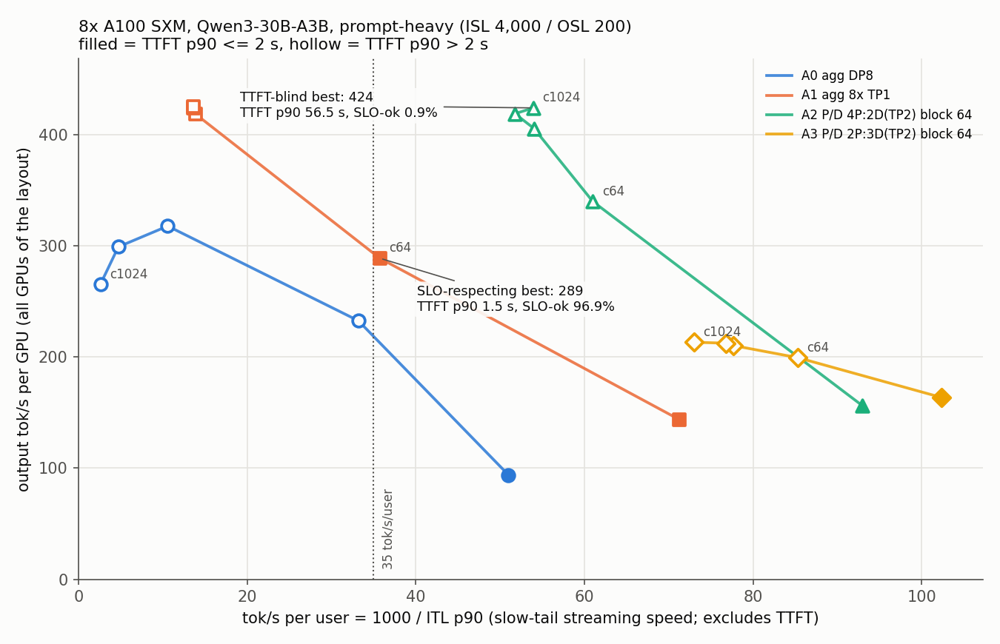
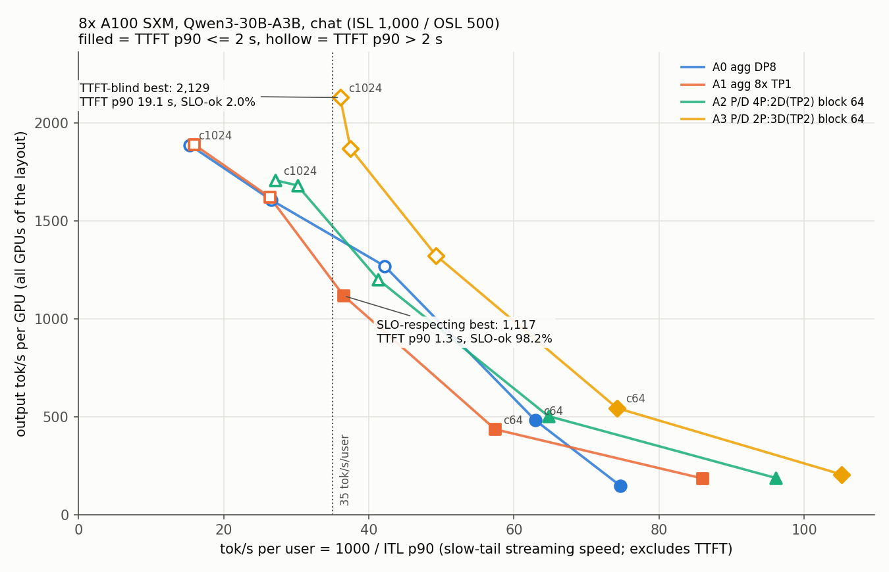

# A100: aggregated vs disaggregated serving on 8 GPUs

> **What you get from this page:** which of four 8-GPU layouts serves the most SLO-meeting requests on 8x A100, why the prefill-to-decode GPU ratio decides P/D on long prompts, and why one expert-sharded server loses to eight independent replicas. A100 numbers only; none is compared with H100.

Terms: **A0** agg DP8 = one vLLM server on 8 GPUs with experts split 8 ways. **A1** agg 8x TP1 = eight independent single-GPU replicas behind a Kubernetes Service. **A2** P/D 4P:2D = 4 TP1 prefill GPUs feeding 2 TP2 decode instances (4 GPUs), block 64. **A3** P/D 2P:3D = 2 prefill GPUs, 3 TP2 decode instances (6 GPUs), block 64. More in the [glossary](glossary.md).

## The answer first

| Question | Answer | Conditions |
|---|---|---|
| Chat: which layout wins? | **A1, eight independent replicas: 2.19 req/s/GPU** vs 1.09 for the best P/D (A3), 2.0x | Best point with >= 90% SLO-ok (TTFT <= 2 s, ITL <= 50 ms). A1 at c256: TTFT p90 1.33 s, ITL p90 27.4 ms. Single runs |
| Prompt-heavy: which layout wins? | **A1: 1.40 req/s/GPU** vs 0.81 for the best P/D at >= 90% SLO-ok | A1 at c64 (TTFT p90 1.48 s, ITL p90 28.0 ms, SLO-ok 96.9%). The ladder is coarse: A2 jumps from 100% SLO-ok at c16 to 81.2% at c64, so its 90% capacity lies between rungs |
| And at any attainment? | Prompt-heavy **tie**: A1 1.40 vs A2 1.38. Chat: A1 2.74 vs A2 2.30 (+19%) | Peaks at c64 (prompt-heavy) and c512 (chat). Share of requests missing the SLO at those peaks: A1 3% and 16%, A2 19% and 32% |
| How much does a TTFT-blind frontier overstate P/D? | **+46.8%** on prompt-heavy (424 vs 289 tok/s/GPU at >= 35 tok/s/user) and **+90.6%** on chat (2,129 vs 1,117) | The 424 point has TTFT p90 56.5 s and 0.9% SLO-ok; 2,129 has TTFT p90 19.1 s and 2.0%. With a looser TTFT p50 <= 2 s filter the prompt-heavy gap is still +24.7% (424 vs 340) |
| What sets P/D throughput on long prompts? | **The number of prefill GPUs.** 4 prefill GPUs carry 16.97 req/s, 2 carry 8.54: 4.24 and 4.27 per prefill GPU | Prompt-heavy c1024, under vLLM's 2,048-token prefill budget on this node |

## Evidence

### 1. Goodput ranking

Latency columns are p50 / **p90** / p99 in ms over measured requests (warm-up excluded).

**Prompt-heavy (ISL 4,000 / OSL 200), best point with >= 90% SLO-ok**

| Layout | Goodput req/s/GPU | at c | SLO-ok | TTFT p50 / p90 / p99 | ITL p50 / p90 / p99 | out tok/s/GPU |
|---|---|---|---|---|---|---|
| A1 agg 8x TP1 | **1.40** | 64 | 96.9% | 631 / **1,479** / 2,498 | 20.8 / **28.0** / 31.4 | 289 |
| A3 P/D 2P:3D | 0.81 | 16 | 99.5% | 374 / **640** / 1,811 | 9.5 / **9.8** / 9.9 | 164 |
| A2 P/D 4P:2D | 0.78 | 16 | 100.0% | 362 / **543** / 1,079 | 10.5 / **10.8** / 10.9 | 157 |
| A0 agg DP8 | 0.47 | 16 | 100.0% | 654 / **1,280** / 1,776 | 17.8 / **19.6** / 20.3 | 94 |

Peak at any attainment: A1 1.40 (c64), **A2 1.38 (c64, SLO-ok 81.2%, TTFT p90 2.95 s)**, A4 (A2 at block 16) 1.18, A0 0.95, A3 0.81. A1 and A2 are a tie at their peaks.

**Chat (ISL 1,000 / OSL 500), best point with >= 90% SLO-ok**

| Layout | Goodput req/s/GPU | at c | SLO-ok | TTFT p50 / p90 / p99 | ITL p50 / p90 / p99 | out tok/s/GPU |
|---|---|---|---|---|---|---|
| A1 agg 8x TP1 | **2.19** | 256 | 98.2% | 477 / **1,333** / 2,102 | 24.6 / **27.4** / 28.2 | 1,117 |
| A3 P/D 2P:3D | 1.09 | 64 | 100.0% | 301 / **1,413** / 1,840 | 13.1 / **13.5** / 13.5 | 543 |
| A2 P/D 4P:2D | 1.01 | 64 | 100.0% | 281 / **821** / 1,041 | 14.8 / **15.4** / 15.5 | 503 |
| A0 agg DP8 | 0.96 | 64 | 100.0% | 711 / **899** / 1,006 | 15.4 / **15.9** / 16.4 | 481 |

Peak at any attainment (all at c512): A1 2.74 (SLO-ok 84.4%), A0 2.44, A2 2.30, A3 2.19. Every point and percentile: [`data/derived/TABLES.md`](../data/derived/TABLES.md).

### 2. The frontier, both ways

> <i>The P/D lines climb only by stacking requests in the prefill queue; every P/D point above c16 is hollow.</i>

> <i>A3 tops the chat chart and ranks last on chat goodput: the chart rewards streaming speed after a 10 to 19 s wait.</i>

| Shape | Floor (tok/s/user) | TTFT-blind best | its TTFT p90 / SLO-ok | SLO-respecting best (TTFT p90 <= 2 s) | its TTFT p90 / SLO-ok | Overstatement |
|---|---|---|---|---|---|---|
| prompt-heavy | >= 20 and >= 35 | 424 (A2, c1024) | 56,520 ms / 0.9% | 289 (A1, c64) | 1,479 ms / 96.9% | +46.8% |
| prompt-heavy | >= 50 | 424 (A2, c1024) | 56,520 ms / 0.9% | 164 (A3, c16) | 640 ms / 99.5% | +159% |
| chat | >= 20 and >= 35 | 2,129 (A3, c1024) | 19,085 ms / 2.0% | 1,117 (A1, c256) | 1,333 ms / 98.2% | +90.6% |
| chat | >= 50 | 543 (A3, c64) | 1,413 ms / 100% | same | same | 0% |

### 3. Where each request waits

Mean ms per request from vLLM histograms on every pod ([`data/a100/stage-timings.md`](../data/a100/stage-timings.md)). "Decode queue" includes the wait for the KV to arrive.

| Layout, load | prefill queue | prefill compute | decode queue | NIXL transfer | ITL (server) | client TTFT mean |
|---|---|---|---|---|---|---|
| A2 4P:2D, prompt-heavy c64 | 766 | 401 | 52 | 26 | 15.4 | 1,174 |
| A2 4P:2D, prompt-heavy c256 | **9,209** | 463 | 57 | 26 | 16.5 | 10,175 |
| A2 4P:2D, prompt-heavy c1024 | **45,000** | 466 | 59 | 26 | 16.7 | 47,209 |
| A3 2P:3D, prompt-heavy c64 | **4,243** | 465 | 40 | 21 | 10.4 | 4,864 |
| A3 2P:3D, prompt-heavy c1024 | **94,053** | 469 | 43 | 22 | 11.3 | 97,762 |
| A2 4P:2D, chat c1024 (2 decode instances) | 1,840 | 167 | **11,794** | 126 | 34.6 | 16,353 |
| A3 2P:3D, chat c1024 (3 decode instances) | **12,098** | 261 | 67 | 15 | 25.8 | 13,584 |

- **Prompt-heavy P/D is bound by the prefill queue while the decode idles.** At A2 c256, 90% of client TTFT is prefill queue; prefill compute stays under 470 ms and decode ITL stays at 10 to 17 ms.
- **Chat P/D saturates whichever side has fewer slots.** A2's two decode pods sat at about 511 running requests in total with 355 to 439 waiting, which looks like a per-engine running-request cap (about 256 each) rather than a KV limit (1,024 x 1,500 tokens = 1.54M vs 1.82M of decode KV; the cap was not read from the pod config). A3's third decode instance removes that queue and moves it to its two prefill pods.

### 4. Prefill GPU count sets prompt-heavy P/D throughput

| Layout | Prefill GPUs | Prompt-heavy req/s at c1024 | req/s per prefill GPU | out tok/s/GPU |
|---|---|---|---|---|
| A2 4P:2D | 4 | 16.97 | 4.24 | 424 |
| A3 2P:3D | 2 | 8.54 | 4.27 | 213 |

Halving the prefill tier halved throughput; the extra decode instance in A3 bought nothing on this shape. A2 at saturation only matches A1 (17.02 req/s), while spending 4 of its 8 GPUs on decode instances that run at 16 to 17 ms ITL with almost no queue. A layout with more prefill and less decode (for example 6 prefill TP1 and 1 decode TP2) is the obvious next arm; it was not run. Chat needs the opposite ratio, so no single ratio fits both shapes.

### 5. One expert-sharded server loses to eight replicas on long prompts

- **Capacity.** An A0 DP8 rank holds 644,720 KV tokens; an A1 TP1 pod holds 141,008, 4.6x less.
- **Result.** A0 still loses on prompt-heavy: 266 to 318 output tok/s/GPU against 419 to 426 for A1 at c256 to c1024, with ITL p90 94.5 ms at c256 and 383.9 ms at c1024 (A1: 72.0 and 73.5 ms). On chat they tie at saturation (1,887 vs 1,889 tok/s/GPU at c1024).
- **Why (likely mechanism, not measured per step).** More KV lets A0 admit more 4,000-token prompts at once, and in an aggregated engine every step that carries prompt chunks slows every decoding stream. The DP ranks of an MoE model also step together through the sharded expert layers, so one rank's long prefill chunk holds up the other ranks' decode steps; A1's eight engines share nothing. The 2,048-token prefill budget vLLM chose on this node is a further confound that was not separated.

### 6. The KV transfer is not the bottleneck

UCX protocol logs show `cuda_ipc` zero-copy GPU reads (NVLink/NVSwitch). A2 and A3 made 24,128 transfers each with 0 failures. Prompt-heavy transfers were 198 MB and 3,024 descriptors (one TP2 rank's half of a 4,000-token prompt) in 22.7 to 26.4 ms; NIXL plus decode queue is about 80 ms of a 10.2 s TTFT at A2 c256. The block-16 comparison (A4) is on [02](02-kv-transfer-block-size.md#4-the-same-effect-on-a100).

### 7. Against common bars

Indicative only: no published benchmark covers this model on A100 (InferenceX has no A100 data), and MLPerf limit values are cited as a bar, not compared with MLPerf results ([method 4](00-method.md#4-metrics-the-slo-and-the-percentile-rules)).

| Metric | Common bar | A1 chat, c256 | A1 prompt-heavy, c64 |
|---|---|---|---|
| TTFT | 2,000 ms at p99 (MLPerf conversational limit) | p90 1.33 s, p99 2.10 s | p90 1.48 s, p99 2.50 s |
| Per-token latency | 80 to 200 ms at p99 (MLPerf server limits) | ITL p99 28.2 ms | ITL p99 31.4 ms |
| Streaming speed | InferenceX tiers 30 / 50 / 75 / 100 / 150 / 200 tok/s/user; calculator default 35 | 36.6 tok/s/user (1000 / ITL p90) | 35.7 tok/s/user |
| Attainment | >= 90% (DistServe) | 98.2% | 96.9% |

The best A100 points clear the TTFT bar at p90 but not at p99, and stream just above the 35 tok/s/user calculator default, below InferenceX's default 50 tier.

### Caveats

- **Single runs.** Differences under about 10% are ties.
- **vLLM chose a 2,048-token chunked-prefill budget on A100** (8,192 on H100). Prefill-queue times and the per-prefill-GPU rate hold for this budget only.
- **Effective concurrency** for A1 and the P/D arms is 0.83 to 0.95 at c >= 256 (drain); A0 stayed at 0.98 to 1.00.
- **Confounded layouts.** A0 differs from A1 in expert placement and DP coupling; the P/D arms differ in disaggregation and TP2 decode. These are deployable configurations, not one-variable tests.
- **Cost.** No citable A100 rate was found. Use `$/GPU-hour x 1,000,000 / (3,600 x output tok/s per GPU)` with your own rate ([method 6](00-method.md#6-cost)).

## What to do with it

1. **For an MoE model of this size on A100, start with independent single-GPU replicas** behind a balanced router. They won chat by 2x and tied or won prompt-heavy.
2. **If you use P/D for long prompts, size prefill first.** About 4.2 prompt-heavy requests per second per TP1 A100 prefill GPU at 4,000 tokens (under the 2,048-token budget); decode instances beyond what the prefill tier can feed buy nothing.
3. **Size decode slots for chat separately.** The same 8 GPUs cannot hold the right ratio for both shapes.
4. **Do not pick a P/D ratio from the frontier chart.** Plot TTFT p90 next to it, or rank by goodput.
5. **Measure at intermediate loads** (c32, c128) before sizing: on a 16 / 64 / 256 ladder the 90% capacity can sit anywhere between rungs.
