# Autoscaling: prefix affinity starves new pods; the planner adds one replica per cold start

> **What you get from this page:** what happens when an autoscaler adds pods behind a prefix-aware router, measured on 8x A100 with llm-d's KEDA path and NVIDIA Dynamo's planner under the same burst; which router setting makes new pods useless; and how long scale-out really takes.

Terms: **KEDA** = Kubernetes event-driven autoscaler; here it scales on the router's in-flight request count. **HPA** = the Kubernetes Horizontal Pod Autoscaler that KEDA drives. **Prefix-affinity filter** = an llm-d router stage that keeps only pods already holding most of a prompt's prefix. **Planner** = Dynamo's autoscaler. **Cold start** = time from a new pod starting to serving (model load, compilation, CUDA-graph capture).

## The answer first

- **With llm-d's prefix-aware profile on, KEDA's new pods served 0 requests.** KEDA scaled 2 to 8 pods within 21 s of a burst; the 6 new pods became Ready about 3 minutes later and then received **no traffic for the rest of the burst**, while the 2 original pods each kept 256 requests running. Six allocated GPUs sat idle.
- **A load-only router profile fixes it.** Same test, prefix producer and affinity filter removed: each new pod took 908 to 1,242 requests, burst TTFT p99 fell from 1,197 to 164 ms and ITL p50 from 61.7 to 31.5 ms after scale-out, and client output rose 36%.
- **The one config knob that could help did not, at the value tested.** `explorationProbability: 0.2` got the 6 new pods 498 requests in total (about 6,500 in the control) and made ITL worse (78.1 ms).
- **Dynamo's KV router did not starve its new worker** (1,659 requests, load parity in about 11 s), **but its planner adds one replica per cold start**: only 3 of a possible 8 workers were Ready during the 6-minute burst.
- **Cold start is about 3 minutes per pod** even with the image pre-pulled and weights on local disk; model loading is only 16 to 21 s of it.

All results are single runs on the A100 node, aggregated (not P/D) TP1 pods.

## Evidence

### 1. Test design

| Item | Value |
|---|---|
| llm-d path | llm-d `workload-autoscaling/keda-epp` guide; KEDA 2.20.2, Prometheus trigger on `sum(llm_d_epp_inflight_requests)`, target 16 per replica, 2 to 8 replicas |
| Deviations from the guide | min 2 replicas (guide 1); HPA scale-up stabilization **0 s** (guide 300 s) and scale-down 60 s (guide 300 s), so both directions fit in a 14-minute test. With guide defaults, expect scale-up up to 5 minutes later |
| Model servers | TP1 pods, vLLM 0.32.0, prefix caching, block 64, image pre-pulled, weights on local disk |
| Load | AIPerf, 32 prefixes x 700 tokens + 300 unique tokens, 300 output tokens. Client A at c32 for 840 s; client B at c480 for 360 s starting at +60 s: **512 in flight during the burst** |
| Sampling | Deployment, HPA and Prometheus every 5 to 6 s; per-pod running, waiting, KV usage, hits and request totals |
| Dynamo arm | Dynamo 1.5.1 aggregated, `--router-mode kv` with KV events, vLLM TP1 workers (0.28 runtime, block 16), planner in load mode, 2 to 8 GPUs, 10 s decision interval, scale up above 50% KV utilization |

### 2. The new pods starve

> <i>The autoscaler measured the demand correctly; the router discarded the capacity it added.</i>

Times relative to the burst reaching the router. Latency is p50 / p99 per phase window (p90 was not computed for these windows). Source: [`data/server-metrics.json`](../data/server-metrics.json) (`autoscaling_a100`).

| | Prefix affinity on (guide default) | Load-only control | Affinity + `explorationProbability: 0.2` |
|---|---|---|---|
| HPA 2 to 4 / 4 to 8 pods | +6 s / +21 s | +7 s / +22 s | about +3 s / +18 s |
| New pods Ready after container start | about 3:00 to 3:05 | about 3:15 | similar |
| Requests per new pod (6 pods) | **0, 0, 0, 0, 0, 0** | **908 to 1,242** | 0, 43, 50, 95, 142, 168 |
| Requests per original pod | about 6,475 each, 256 running | 5,126 and 4,861 | pinned at 256 running |
| Burst TTFT p50 / p99, after all 8 Ready | 440 / 1,197 ms | **122 / 164 ms** | 356 / 1,843 ms |
| Burst ITL p50, after all 8 Ready | 61.7 ms | **31.5 ms** | 78.1 ms |
| Burst client output | 7,734 tok/s | **10,551 tok/s (+36%)** | 7,117 tok/s |
| Engine prefix hit | 95.5% | 93.5% | 94.5% |

- **Latency did not change when the new pods became Ready** with affinity on (burst TTFT p50 453 ms before, 440 ms after; ITL p50 59.8 vs 61.7 ms). The same c32 client saw ITL p50 18.6 ms before the burst.
- **Only about 2.3 of the 6 burst minutes ran on 8 pods**, so the control's +36% understates the steady-state gain.
- **Hit rates are high in every arm** because AIPerf's synthetic dataset repeats; the arms are comparable with each other, not with real traffic.

### 3. Why (from the router source, not measured)

1. **Only "sticky" pods are candidates.** A pod is sticky for a request if it holds at least 80% of the prompt's prefix blocks. When any pod is sticky, all others are dropped. A new pod has no entries, so it is never a candidate.
2. **Stickiness feeds itself.** The approximate index records where the router sent each prefix, not what the engine cached. A new pod gets entries only by receiving traffic, which the filter prevents.
3. **The release valve cannot see decode load.** Stickiness breaks only when the sticky pod's estimated TTFT exceeds the others' by 18,000 ms, and that estimate counts only uncached prompt tokens in flight (about 287k uncached tokens would be needed to trip it). A pod with 256 decoding streams and mostly cached prompts looks idle.

The control removed the prefix producer and the filter together, so the experiment implicates the prefix-aware profile; attributing it to the filter rests on the code reading. One question stays open: the workload shares 700 of about 1,000 tokens (a 0.67 match, below 0.80), yet starvation was total. The likely reason is that AIPerf's bounded synthetic dataset also repeats the "unique" tails; the filter's decision counter was not captured to confirm it.

**Why exploration 0.2 was not enough.** Skipping the filter for 1 request in 5 lets a new pod pick up some prefix groups, but those groups stay sticky on the old pods too, so the other 80% of requests keep landing there. Locality survived (94.5%); capacity did not. Higher values (0.5, for example) were not measured.

### 4. Dynamo's planner on the same test

| Event | Time |
|---|---|
| First scale-up decision (2 to 3) | **+1 s** |
| Every 10 s tick while the new worker loads | "scaling in progress": hold |
| Worker 3 Ready | +200 s (3:12 cold start) |
| Scale-up 3 to 4 | +201 s |
| Burst ends | about +375 s |
| Worker 4 Ready | after the burst ended |
| Scale-down 4 to 3 to 2 | +37 s and +57 s after the burst |

- **No starvation.** Worker 3 completed 1,659 requests after Ready and reached the old workers' load within about 11 s; it never exceeded them by more than about 25 running-plus-waiting. Dynamo's KV router charges each worker for the blocks of all its active sequences, so a saturated worker is expensive however much prefix it holds, and an empty one is cheap.
- **The planner is the bottleneck instead.** Each decision moves one replica and waits for it to be Ready. At about 3.2 minutes per cold start, going from 2 to 8 workers would take about 19 minutes, against a 6-minute burst.
- **Latency** (p50 / p99): burst TTFT 374 / 4,927 ms on 2 workers, 247 / 721 ms with 3 Ready; ITL p50 58.3 and 55.4 ms. Burst client output 8,248 tok/s. 0 errors, including a scale-down that removed a worker carrying about 8 in-flight requests.
- **A logged utilization above 1** (1.974 at the scale-up decision) suggests the planner counts a shared prefix once per request rather than once per resident block. Observation; the comparison against the threshold is still monotone.

### 5. Side by side

| | llm-d KEDA, affinity on | llm-d KEDA, exploration 0.2 | llm-d KEDA, load-only | Dynamo planner |
|---|---|---|---|---|
| First scale decision | +6 s | about +3 s | +7 s | **+1 s** |
| Scale steps | 2 to 4 to 8 within 21 s | within 18 s | within 22 s | **+1 per cold start** |
| Peak Ready during burst | 8 | 8 | 8 | **3** |
| Requests per new pod | **0** | 0 to 168 | 908 to 1,242 | 1,659 |
| Burst TTFT p50 / p99 after scale-out | 440 / 1,197 ms | 356 / 1,843 ms | **122 / 164 ms** | 247 / 721 ms |
| Burst ITL p50 after scale-out | 61.7 ms | 78.1 ms | **31.5 ms** | 55.4 ms |
| Burst client output | 7,734 tok/s | 7,117 tok/s | **10,551 tok/s** | 8,248 tok/s |

### Cold start, where the 3 minutes go

Scheduling plus a pre-pulled image: 1 to 2 s (a cold 8.4 GiB image pull took 134 s on this node). Model load: 16 to 21 s. The rest is `torch.compile` and CUDA-graph capture, with no compile cache shared between pods. These are best-case numbers with local weights.

### Caveats

- One run per arm, one exploration value, and a shortened HPA stabilization window.
- The Dynamo arm used a different engine version (vLLM 0.28 runtime) and block size (16), and its planner scales on KV utilization rather than in-flight requests; the KEDA threshold could not be mirrored exactly.
- Scale-down was tested only with idle or lightly loaded pods; drain under load was not tested.

## What to do with it

1. **Do not combine an in-flight autoscaler with the prefix-affinity filter on its defaults.** Use a load-only profile for bursty traffic, or make sure the router's release valve counts running and queued requests, not only uncached prefill tokens.
2. **Test new-pod uptake explicitly:** after any scale-out, check per-pod request counters (`vllm:request_success_total`) within a minute of Ready.
3. **Budget about 3 minutes per cold start** for this model on A100 even with local weights; pre-compile or share compile caches if bursts are shorter than that.
4. **With a one-step planner, set the minimum replica count for the burst you expect.** At one replica per cold start it cannot follow a burst shorter than about 20 minutes from 2 to 8 workers.
